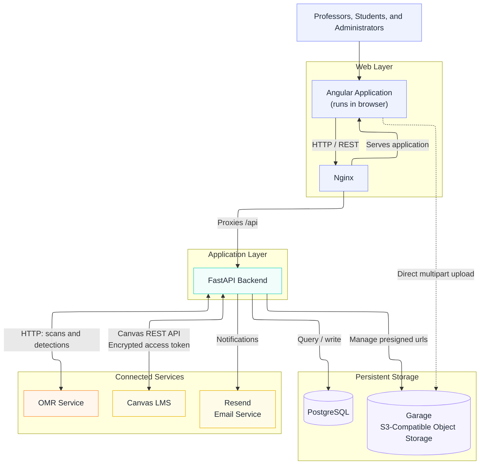
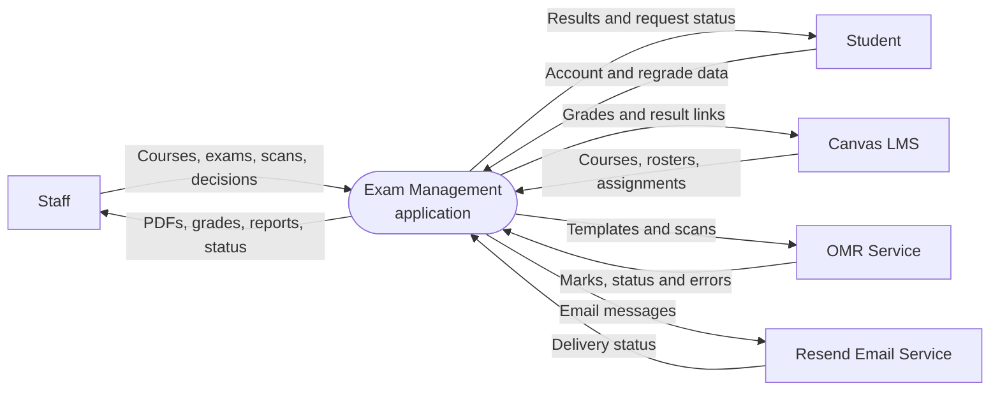
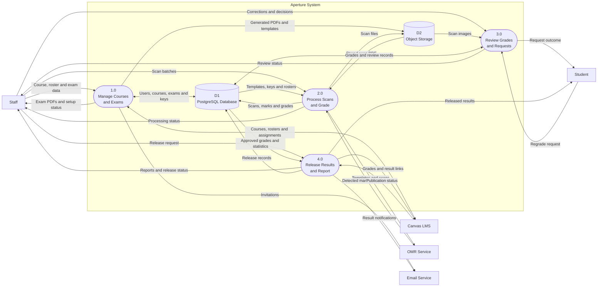
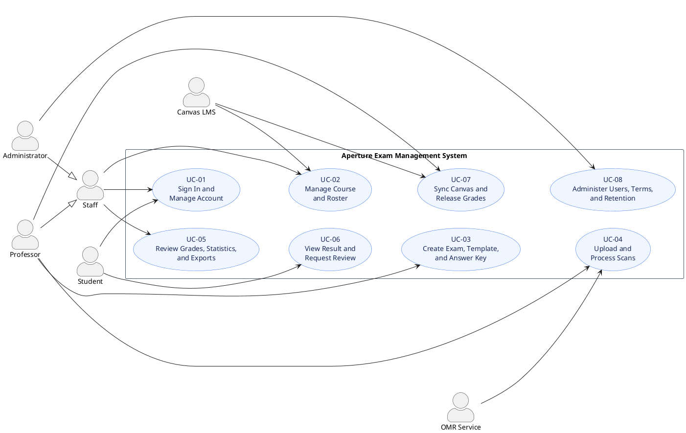

---
title: OMR System Final Project Report

---

# OMR System — Final Project Report

> Preserved capstone submission. See the [portfolio overview](../portfolio/case-study.md),
> [current test evidence](../portfolio/testing.md), and [setup notes](../portfolio/local-setup.md)
> for this portfolio copy. External images and submission-era results below are historical.
> The retained PDF is the original report.

## Document Information

| Item            | Details                                                                             |
| --------------- | ----------------------------------------------------------------------------------- |
| Project title   | OMR System                                                                          |
| Team            | Team 15                                                                             |
| Team members    | Kaden Harris, Joel deHoog, Nathan Worth, Chad Glazier, Graeme Brown, Tyson Livadney |
| Course          | COSC 499 Capstone                                                                   |
| Client          | Dr. Ramon Lawrence, Professor at UBC                                                |
| Submission date | 9 August 2026                                                                       |
| Repository      | https://github.com/UBCO-COSC499-S2026/capstone-team-15                              |

## Table of Contents

1. [Overview Description](#1-overview-description)
2. [System Architecture](#2-system-architecture)
3. [System Features (Total System)](#3-system-features-total-system)
4. [Status of the System Features](#4-status-of-the-system-features)
5. [UX Analysis](#5-ux-analysis)
6. [PM Activities and WBS/FBS](#6-pm-activities-and-wbsfbs)
7. [Lessons Learned and Project Reflections](#7-lessons-learned-and-project-reflections)
8. [Hand-over, Installation, and Setup](#8-hand-over-installation-and-setup)
9. [Conclusion](#9-conclusion)
10. [Appendices](#10-appendices)


# 1. Overview Description


## 1.1 Project and Team Overview

Our Client is Professor Ramon Lawrence, he is the department head of Computer Science and Director of the Master of Data Science program. He has contracted us to produce this OMR system.

Team 15 is Kaden Harris, Joel deHoog, Nathan Worth, Chad Glazier, Graeme Brown, and Tyson Livadney. The team charter began with Kaden, Chad, Graeme, and Tyson focused mainly on backend work, and Joel and Nathan focused mainly on frontend work. In practice, we moved to working on entire features as we found that to be more efficient.

The OMR System is a web application for creating, scanning, grading, reviewing, and managing optically marked multiple-choice exams. It keeps the familiar paper exam, but moves setup, grading, review, and release into one browser-based workflow. Teaching staff can manage courses and rosters, create exams and answer keys, upload batches of scanned answer sheets, review uncertain marks, correct grades, view statistics, export results, and release grades. Students can view released results and marked sheets and ask for a review. Administrators can manage accounts, roles, academic terms, and record-retention work.

The final product runs as a group of Docker services. Angular provides the web interface. FastAPI holds the main business rules and API. PostgreSQL stores structured data. Garage stores PDFs and images. A separate Go/OpenCV service handles scan cleanup and mark detection. Canvas integration uses the Canvas REST API and encrypted personal access tokens to import course data and release grades. The final user roles are student, professor, and administrator. 

## 1.2 Product Approach and Key System Requirements

The exam workflow for instructors is split into clear stages. An authenticated professor:

1. sets up the course and exam,
2. creates or imports an answer key, then
3. uploads a batch PDF for grading. 

From there, the system:

4. detects the student, exam version, and answers,
5. grades the detected marks, then
6. requests manual review for uncertain marks.

Once any ambiguities are resolved, the instructor may release the results (which are distributed by the system). The system will retain or archive records according to a configurable retention policy (Defaulted to UBC's exam retention policy). Authentication checks protect each stage and ensures that results are kept private.

The main requirements are reliable, asynchronous batch processing of scanned bubble sheets; support for standard UBC 100-question sheets as well as reusable custom templates with up to 100 answer choices per question; clear detection and manual review of blank, ambiguous, duplicate, missing, or mismatched responses; manual correction of detected responses and marks with a full audit trail; exam and question-level statistics including five-number summaries, response distributions, and term-over-term comparisons; strict separation and protection of student records, including student-only access to their own results; CSV export and Canvas integration for grades, marked scans, and secure token-based student access; and a containerized, repeatable deployment that separates the web application, database, storage, and grading components. The approved requirements tables in Section 1.5 are preserved without changing their wording or status values.

## 1.3 Unique Value Proposition

Our OMR system packages a faster engine outclassing other solutions, capable of marking exams at a rate of ~800 pages per minute*. Professors also gain an interactive exam review page for intuitive and simple grade editing. Our system also provides a very flexible exam layout editor, allowing nearly endless possibilities to create custom exams and templates. To top it all off we have integration with Canvas to allow for convenient account and grade management out of the box.

> *Benchmarked on an AMD Ryzen 5 7400F 6-Core Processor. PDFs were sent directly to the OMR in 200-page batches and rendered at 250 DPI.

## 1.4 User Groups and Their Needs

| User group | What they need | What the product provides |
|---|---|---|
| Students | Private access to their own grade, a clear explanation, and a way to question a result | Released results, marked exam images, score context, notifications, and review requests |
| Professors/Instructors | Fast exam setup, reliable batch grading, exception review, statistics, and export | Course and roster tools, exams and keys, scan upload, OMR, corrections, analytics, CSV, Canvas, and notifications. |
| Administrators | Account control, system oversight, and data-lifecycle tools | User and role management, account status and sessions, academic terms, archive cleanup, and retention settings |
| Canvas | A convenient way to exchange course, roster, assignment, and grade data | Token-based course import, roster sync, assignment linking, grade release, and signed student-result links |

## 1.5 Requirements Summary

### 1.5.1 Rubric-Level Requirement Categories

The project plan identifies the following cross-cutting requirements in addition to the approved tables below:

- **Non-functional:** students may only access their own results; the target system supports courses of 10,000 or more students; exams may contain up to 100 questions with four or five choices; and batch work runs asynchronously. The access controls and asynchronous pipeline are present in code. A 10,000-student performance result was not found and still needs a final benchmark.
- **Technical:** the application is containerized and separates the Angular client, FastAPI API, PostgreSQL database, Garage object storage, and Go/OpenCV grader. Nginx serves the production client and routes API traffic.
- **User:** teaching staff can define exams and keys, upload scans, review uncertain marks, and export results; students can view released results and ask for a review; administrators can manage access and retention.
### 1.5.2 Non-functional, Technical, and User Requirements

| ID | Description | Status |
|---|---|---|
| UR1.1 | Must log in using a secure username/password. | Complete |
| UR1.2 | Must be able to create, update, deactivate, and manage user accounts. |  Complete |
| UR1.3 | Must be able to assign and modify user roles. | Complete |
| UR1.5 | Must be able to monitor system usage and performance. | Complete |
| UR1.6 | Must be able to enforce privacy, security, and data retention policies. | Complete |
| UR2.1 | Must log in securely using a supported authentication method. | Complete |
| UR2.2 | Must be able to recover passwords when local authentication is used. | Complete |
| UR2.3 | Must be able to create and manage courses. | Complete |
| UR2.4 | Must be able to view a dashboard of current and previous courses. |  Complete |
| UR2.5 | Must be able to add students using CSV uploads or invite links. | Complete |
| UR2.6 | Must be able to create and manage exam events. | Complete |
| UR2.7 | Must be able to create bubble-sheet exams with configurable numbers of questions and answer choices and that encode exam event, course, exam version and student identifier | Complete |
| UR2.8 | Must be able to use standard UBC 100-question bubble sheets. | Complete |
| UR2.9 | Must be able to reuse custom bubble-sheet templates. | Complete |
| UR2.10 | Must be able to import answer keys for exams. | Complete |
| UR2.11 | Must be able to define and modify answer keys. | Complete |
| UR2.12 | Must be able to assign point values to questions. | Complete |
| UR2.13 | Must be able to support questions with single-answer, multiple-answer, and combined-answer marking schemes. | Complete |
| UR2.14 | Must be able to support multiple versions of the same exam. | Complete |
| UR2.15 | Must be able to upload scanned bubble-sheet exams for optical recognition grading. | Complete |
| UR2.16 | Must be able to process uploaded scans in batches. | Complete |
| UR2.17 | Must be notified when exam processing is complete. | Complete |
| UR2.18 | Must be able to review scanned sheets when OMR issues are detected. | Complete |
| UR2.19 | Must be able to identify duplicate, missing, invalid, or unrecognized student identifiers. | Complete |
| UR2.20 | Must be able to identify version mismatches and scanning issues. | Complete |
| UR2.21 | Must be able to manually review flagged scans. | Complete |
| UR2.22 | Must be able to manually modify detected responses and assigned marks. | Complete |
| UR2.23 | Must be able to view how a question was marked. | Complete |
| UR2.24 | Must be able to view overall exam statistics. | Complete |
| UR2.25 | Must be able to view a five-number summary for an exam. | Complete |
| UR2.26 | Must be able to view response distributions for each question. | Complete |
| UR2.27 | Must be able to compare performance across exams, terms, and years. | Complete |
| UR2.28 | Must be able to compare current performance with historical performance. | Complete |
| UR2.29 | Must be able to export exam results as csv. | Complete |
| UR2.30 | Must be able to release or close exam results. | Complete |
| UR2.31 | Must be able to review and resolve student grading disputes. | Complete |
| UR2.32 | Must be able to upload grades and marked exam results to Canvas | Complete |
| UR3.1 | Must be able to access released exam results. | Complete |
| UR3.2 | Must be able to view exam scores. | Complete |
| UR3.3 | Must be able to view a digital copy of their marked exam when permitted. | Complete |
| UR3.4 | Must be able to view their responses and correct responses when permitted. | Complete |
| UR3.5 | Must be able to verify how their exam was marked. | Complete |
| UR3.6 | Must be able to submit a grading review request. | Complete |
| UR3.7 | Must be able to access the system. | Complete |

### 1.5.3 Functional Requirements

| ID | Functional requirement | Final status |
|---|---|---|
| FR1.1 | The system must support secure authentication. | Complete |
| FR1.2 | The system must support password recovery for locally managed accounts. | Complete |
| FR1.3 | The system must maintain audit records for authentication and account activities. (bonus) | Incomplete |
| FR2.1 | The system will allow instructors to create, modify, archive, and manage courses. | Complete |
| FR2.2 | The system will support CSV-based roster imports. | Complete |
| FR2.3 | The system will support student enrollment through invite links. | Complete |
| FR2.4 | The system must restrict course access to authorized users. | Complete |
| FR3.1 | The system will support creation and management of exam events. | Complete |
| FR3.2 | The system will support standard UBC 100-question bubble sheets. | Complete |
| FR3.3 | The system will support custom bubble-sheet templates. | Complete |
| FR3.4 | The system will allow custom templates to be reused across courses. | Complete |
| FR3.5 | Generated bubble sheets must encode course, exam event, exam version, and student identifiers. | Complete |
| FR3.6 | Encoded metadata must be used to associate scans with the correct exam event and answer key. | Complete |
| FR3.7 | The system will support multiple versions of the same exam. | Complete |
| FR4.1 | The system will support answer-key import from structured file formats. | Complete |
| FR4.2 | Imported answer keys must be validated against the exam definition. | Complete |
| FR4.3 | The system will support creation and modification of answer keys. | Complete |
| FR4.4 | The system will support per-question point values. | Complete |
| FR4.5 | The system will support single-answer questions. | Complete |
| FR4.6 | The system will support multiple-answer questions. | Complete |
| FR5.1 | The system will allow instructors to upload scanned bubble-sheet exams. | Complete |
| FR5.2 | The system will support asynchronous batch processing of uploaded scans. | Complete |
| FR5.3 | Instructors must be notified when processing is complete. | Complete |
| FR5.4 | The OMR grader must operate as a separate component from the web application. | Complete |
| FR5.5 | The grader component must expose a defined interface that allows replacement by alternative grading implementations. | Complete |
| FR5.6 | The grader must return detected responses, identifiers, version information, confidence information, and processing errors. | Complete |
| FR6.1 | The system will identify duplicate, missing, invalid, or unrecognized student identifiers. | Complete |
| FR6.2 | The system will identify version mismatches and scan quality issues. | Complete |
| FR6.3 | The system will allow instructors to review flagged scans. | Complete |
| FR6.4 | The system will display scanned images alongside detected responses. | Complete |
| FR6.5 | The system will allow instructors to modify detected responses. | Complete |
| FR6.6 | The system will allow instructors to modify assigned marks. | Complete |
| FR6.7 | The system will maintain an audit trail of manual corrections. | Complete |
| FR7.1 | The system will allow instructors to release or close exam results. | Complete |
| FR7.2 | The system will allow students to view released results. | Complete |
| FR7.3 | The system will allow students to view marked exam scans when enabled. | Complete |
| FR7.4 | The system will display student responses and correct responses when enabled. | Complete |
| FR7.5 | The system will provide a review-request workflow for marking disputes. | Complete |
| FR7.6 | The system will allow instructors to review, respond to, and resolve review requests. | Complete |
| FR7.7 | The system will record all review-request decisions and grading changes. | Complete |
| FR8.1 | The system will compute overall exam statistics including mean, median, minimum, maximum, standard deviation, and five-number summary. | Complete |
| FR8.2 | The system will compute per-question response distributions. | Complete |
| FR8.3 | The system will display the percentage of students selecting each response option. | Complete |
| FR8.4 | The system will provide visualizations of exam and question performance. | Complete |
| FR8.5 | The system will support comparison across exams, terms, and years. | Complete |
| FR8.6 | The system will support comparison against historical performance data. | Complete |
| FR8.7 | The system will provide course-level performance summaries. | Complete |
| FR9.1 | The system will support exporting exam results as CSV. | Complete |
| FR9.2 | Exported results must include student identifiers, exam versions, responses, scores, and exam metadata. | Complete |
| FR9.3 | The system will support downloadable reports. | Complete |
| FR10.1 | The system will integrate with the Canvas API. | Complete |
| FR10.2 | The system will support posting grades to Canvas assignments. | Complete |
| FR10.3 | The system will support posting or linking marked exam scans through Canvas. | Complete |
| FR10.4 | The system will support secure student access from Canvas using time-limited access tokens. | Complete |
| FR10.5 | Canvas access links and tokens must be student-specific and time-limited. | Complete |
| FR11.1 | The instructor and administrator interfaces must be optimized for desktop use. | Complete |
| FR11.2 | The system will provide dashboards summarizing courses, exams, processing status, and released results. | Complete |
| FR11.3 | The system will minimize repetitive instructor data entry through reusable templates and imports. | Complete |
| FR11.4 | The system will provide clear workflow and status notifications. | Complete |
| FR12.1 | Students must only be able to access their own exam information. | Complete |
| FR12.2 | Student information must be protected using appropriate access controls. | Complete |
| FR12.3 | The system will support configurable retention policies for scanned images and exam records. | Complete |
| FR12.4 | The system will support archiving and deletion of records according to institutional policy. | Complete |
| FR12.5 | The system must maintain audit records for grading changes, result releases, and student review requests. | Complete |
| FR12.6 | The system must comply with relevant privacy regulations and institutional policies. | Complete |
| FR13.1 | The system will allow administrators to monitor system usage and performance. | Complete |
| FR13.2 | The system will allow monitoring of grading jobs and processing failures. | Complete |
| FR13.3 | The system architecture will separate the web application, database, storage layer, and grader worker into maintainable components. | Complete |
| FR13.4 | The system will support replacement of the grading engine without requiring significant changes to the user-facing application. | Complete |
| **(Bonus)** FR14 | Let administrators manage users, roles, status, sessions, and archive cleanup | Complete |
| **(Bonus)** FR14.1 | Let administrators view OMR specific analytics, such as job status and system resource usage | Complete |
| **(Bonus)** FR15 | Apply configurable retention rules and permanently condense eligible archived courses | Complete |

* Audit logs is partially complete, but deemed not safe to merge with the amount of time left.
# 2. System Architecture

## 2.1 Architecture Overview and Rationale

Our OMR System uses a client–server architecture. Users interact with an Angular web client, which sends requests to a central FastAPI server. The server contains the main business logic and manages authentication, courses, exams, grades, and Canvas integration. It stores structured data in PostgreSQL and uploaded files in Garage object storage. Scan grading is handled by a separate OMR service through a defined API.

This design fits a six-person team and a single-product deployment. It avoids the operational cost of splitting every business area into a microservice, while keeping OpenCV work replaceable behind an HTTP interface. PostgreSQL gives the system transactions and constraints for grades and accounts. Garage keeps large PDFs and images out of the database. Docker Compose gives developers and production a repeatable topology. The main reliability trade-off is that scan work starts as an in-process background task; a durable queue would be the next step if the deployment needs stronger crash recovery or independent worker scaling.



Figure 1. Final deployed architecture. The browser receives the Angular application from the development server or production Nginx, uses FastAPI for API requests, and transfers scan chunks directly to Garage using presigned URLs. FastAPI coordinates PostgreSQL, Garage, the Go OMR service, Canvas, and email. The OMR service keeps its working data on its own volume.


## 2.2 Technology Stack and Justification

| Layer | Technology and version | Why it fits | Main trade-off |
|---|---|---|---|
| Web client | Angular, RxJS | Typed components, routing, forms, guards, and test support | Larger framework and linked package versions |
| Charts | Chart.js | Small, familiar chart library for exam and system summaries | Canvas charts need careful resizing and accessibility text |
| Main API | Python, FastAPI, Pydantic | Fast typed API work and asynchronous I/O | CPU-heavy image work should stay outside the API process |
| Data access | SQLAlchemy, asyncpg, Alembic | Async PostgreSQL access and versioned schema changes | Migrations must run before a new release starts |
| Database | PostgreSQL 16 Alpine | Transactions, constraints, relationships, and JSON support | Needs backup and persistent-volume management |
| Object storage | Garage, boto3 | S3-compatible storage and presigned multipart upload | Adds storage configuration, CORS, and backup duties |
| PDF and image tools | Pillow, PyMuPDF, ReportLab | Scan rendering, generation, and annotation | File validation and resource limits matter |
| Security | JWT , Argon2, encrypted Canvas tokens | Short API sessions, refresh sessions, strong passwords, and protected Canvas secrets | Secrets and token rotation must be configured correctly |
| Tests | pytest, Vitest, Go test | A native test tool for each language | Must be run manually, for Go test CI would need to build the docker container which is very expensive |
| Deployment | Docker Compose, Nginx Alpine | Same service layout across development and production | Simpler than an orchestrator, but limited for horizontal scaling |

## 2.3 Level 0 Data Flow Diagram



Figure 2. Level 0 DFD. 
Staff members are the primary operators of the system. They configure courses and examinations, upload scan batches, review uncertain grades, and release final results. In response, Aperture provides generated examination PDFs, processing status, grades, statistics, and reports.
Students interact with Aperture to manage their accounts, view released results, and submit regrade requests. Canvas supplies course, roster, and assignment information, while Aperture sends finalized grades and secure result links back to Canvas.
The OMR service receives scan files and template information. It returns detected marks, processing progress, and errors. Email delivery is delegated to an external provider.

## 2.4 Level 1 Data Flow Diagram




Figure 3. Level 1 DFD
### 1.0 Manage Courses and Exams
This process manages user enrolment, courses, class rosters, exams, templates, versions, and answer keys. Course information can be entered manually, uploaded through CSV files, or imported from Canvas.
Exam configuration is stored in PostgreSQL. Generated exam PDFs and template files are stored in Garage because they are binary objects. The process can also send course invitations through the email service.
### 2.0 Process Scans and Grade
Staff upload completed examination scans. The backend handles streaming files from the frontend directly to Garage. The backend then records the completed upload in PostgreSQL.
The scan-processing process retrieves the PDF and appropriate template and sends them to the OMR service. The OMR service returns detected marks or processing errors. Aperture compares the detected answers with the stored answer key, attempts to match the detected identity against the course roster, calculates a grade, and flags uncertain results for review.
### 3.0 Review Grades and Requests
Staff inspect grades that could not be finalized automatically. This includes ambiguous marks, uncertain student identities, missing examination versions, and other processing problems. Staff can view scan images, correct detected answers, associate a scan with a student, and approve the resulting grade.
Students can submit regrade requests after results have been released. The request, staff decision, grade history, and audit information are stored in PostgreSQL.
### 4.0 Release Results and Report
Once grades have been reviewed, staff can release an exam. Released results become visible to students. The same process calculates examination statistics and course comparisons for staff.
For Canvas-linked courses, approved grades and secure result links can be published to a selected Canvas assignment. Publication results and failures are recorded in PostgreSQL. The system can also send result and release notifications through the email provider.

### System Start up
Docker Compose creates a shared network for the services and persistent volumes for PostgreSQL and Garage. In production, the migration container must complete successfully before FastAPI starts. Health checks verify PostgreSQL, Garage, FastAPI, the frontend, and the OMR service. Nginx exposes the application through the configured public port, while the other services communicate on the internal Docker network.

# 3. System Features (Total System)

## 3.1 Complete Feature List

| ID | Feature | Includes | Related Requirements | Contributors |
|---|---|---|---|---|
| F-01 | Accounts and authentication | Registration, activation, login, refresh, logout, password reset, preferences | FR1.1–FR1.3, FR12.1–FR12.2 | Joel, Nathan, Tyson, Graeme, Kaden |
| F-02 | Administration | User list/create/edit/delete, status, roles, sessions, dashboard | FR13.1–FR13.2, FR14–FR14.1 | Joel, Nathan, Tyson, Graeme, Kaden |
| F-03 | Courses, terms, and rosters | Course lifecycle, academic terms, CSV roster, invitations, staff promotion | FR2.1–FR2.4 | Nathan, Joel, Tyson, Kaden, Graeme |
| F-04 | Exams, templates, and answer keys | Exam events, generated PDFs, reusable templates, versions, manual/scan/CSV keys | FR3.1–FR4.6 | Kaden, Joel, Nathan, Tyson, Graeme |
| F-05 | Scan upload and OMR | Multipart upload, PDF batches, image cleanup, identity/version/mark detection, errors | FR5.1–FR6.4 | Chad, Kaden, Tyson, Joel, Nathan |
| F-06 | Grading and human review | Exact and partial credit, corrections, annotations, grade and review history | FR6.5–FR7.7, FR12.5 | Nathan, Kaden, Joel, Tyson, Graeme, Chad |
| F-07 | Statistics and comparisons | Exam summaries, distributions, question analysis, course comparisons, boxplots | FR8.1–FR8.7 | Tyson, Nathan, Kaden |
| F-08 | CSV support | Roster and answer-key import, result export | FR2.2, FR4.1–FR4.2, FR9.1–FR9.3 | Joel, Nathan, Kaden, Tyson, Graeme |
| F-09 | Canvas integration | Connection, import/sync, assignment linking, grade release, signed result links | FR10.1–FR10.5 | Joel, Nathan, Graeme, Tyson |
| F-10 | Notifications | In-app notices, preferences, completion/failure notices, optional email | FR5.3, FR11.4 | Nathan, Graeme, Tyson, Joel, Kaden |
| F-11 | Student results and review requests | Released marked result, score context, request, response, and resolution | FR7.2–FR7.7 | Nathan, Kaden, Joel, Graeme, Tyson |
| F-12 | Archive and retention | Course archive/restore, policy settings, permanent cleanup state | FR12.3–FR12.4, FR15 | Tyson, Joel, Nathan |

## 3.2 Use-Case Diagram and Detailed Use Cases



**Figure 5. Simple UML use-case overview.** Professor and administrator actors specialize the shared staff role, while Canvas and the OMR service support the course, release, and scan-processing workflows described below.

### Use Case UC-01: Sign In and Manage an Account

| Field | Details |
|---|---|
| Related features | F-01, F-10 |
| Primary actors | Student, professor, administrator |
| Trigger | A person registers, signs in, resets a password, or opens account settings |
| Preconditions | The web client can reach FastAPI; email is configured or development console email is enabled |
| Postconditions | A session is created or revoked, and permitted account changes are saved |

Main flow:

1. The person enters valid account details or credentials.
2. FastAPI validates the request, account status, and Argon2 password hash.
3. The API returns access and refresh tokens.
4. The client uses the access token for protected requests and refreshes it when needed.
5. The person can update details, password, institution, notification settings, or end sessions.

Alternate flows: duplicate email or student number is rejected; invalid or disabled accounts cannot sign in; expired setup/reset links must be replaced; repeated attempts may be rate-limited; an administrator can end all sessions for an account.

### Use Case UC-02: Manage a Course and Roster

| Field | Details |
|---|---|
| Related features | F-03, F-08, F-09 |
| Primary actors | Professor or administrator |
| Trigger | Staff create or open a course |
| Preconditions | The actor is signed in and has access to the course or admin role |
| Postconditions | Course, term, enrollment, roster, invitation, and optional Canvas-link data are saved |

Main flow:

1. Staff create the course and select its academic term.
2. They add students by CSV, invite link, or Canvas roster sync.
3. The backend validates emails, student numbers, duplicates, and permissions.
4. The roster shows enrolled, invited, and unmatched students.
5. Staff may remove a student, resend invitations, promote course staff, archive the course, or restore an eligible archive.

Alternate flows: an invalid CSV returns row-level feedback; duplicate or expired invitations do not create another enrollment; an unauthorized user receives a forbidden response; a retention-processed archive cannot be restored.

### Use Case UC-03: Create an Exam, Template, and Answer Key

| Field | Details |
|---|---|
| Related features | F-04, F-08 |
| Primary actors | Professor or administrator |
| Trigger | Staff create an exam or prepare a reusable bubble-sheet definition |
| Preconditions | A course exists and the actor can manage it |
| Postconditions | The exam, versioned template, generated PDF, and validated answer key are saved |

Main flow:

1. Staff enter the exam name, schedule details, versions, and template choice.
2. They create or reuse a template with the required pages and question layout.
3. The system generates a bubble-sheet PDF that carries identity and version fields.
4. Staff enter an answer key manually or import it from a scan or structured file.
5. The backend checks the key against the exam definition and saves its version and scoring rules.

Alternate flows: an incomplete or incompatible key is rejected; a template in use is archived rather than removed unsafely; generation errors return a clear failure; a scanned key that cannot be read must be corrected or entered manually.

### Use Case UC-04: Upload and Process Scans

| Field | Details |
|---|---|
| Related features | F-05, F-10 |
| Primary actors | Professor or administrator |
| Supporting systems | Garage object storage and Go OMR service |
| Trigger | Staff select a batch PDF for an exam |
| Preconditions | The exam, template, and usable answer key exist |
| Postconditions | One scan record per exam is completed or failed; successful detections are ready for grading |

Main flow:

1. The client asks FastAPI to start a multipart upload.
2. The browser uploads chunks directly to Garage and returns their ETags.
3. FastAPI completes the object and creates a pending scan record.
4. Background processing checks the PDF, determines a useful render density, and sends it to the OMR service.
5. The OMR service returns identities, versions, detected choices, confidence, and page-level errors.
6. FastAPI stores the results, calculates grades, updates status, and notifies course staff.

Alternate flows: missing templates, page-count mismatch, poor scan quality, wrong page order, malformed or oversized PDFs, and OMR failures produce explicit failure codes. A bad item in a batch can fail without hiding the outcome of other items.

### Use Case UC-05: Review Grades, Statistics, and Exports

| Field | Details |
|---|---|
| Related features | F-06, F-07, F-08 |
| Primary actors | Professor or administrator |
| Trigger | Staff open processed exam results |
| Preconditions | At least one scan has reached grading or review |
| Postconditions | Approved corrections and decisions are saved with history; exports reflect current grades |

Main flow:

1. Staff open the grade roster and filter for unmatched, ambiguous, or failed items.
2. They inspect the original or annotated page, detected responses, key, and grade history.
3. They correct a response or score when the evidence supports it.
4. The backend recalculates the grade and writes the audit record.
5. Staff review summary statistics, distributions, question results, comparisons, and CSV output.

Alternate flows: unauthorized corrections are rejected; unresolved identity or version problems block normal release; a missing scan image is reported; a current open issue reports broken statistics-page formatting and is listed in Section 4.4.

### Use Case UC-06: View a Released Result and Request Review

| Field | Details |
|---|---|
| Related features | F-10, F-11 |
| Primary actor | Student |
| Trigger | A student opens an exam result |
| Preconditions | The student is enrolled, the grade belongs to them, and the exam is released |
| Postconditions | The result is shown; any submitted request enters the staff review queue |

Main flow:

1. The student opens the released exam from the course or a signed Canvas link.
2. The system checks ownership, release state, and any time-limited token.
3. The page shows the score, class context, marked sheet, answers, and permitted key details.
4. If something looks wrong, the student selects the affected questions and explains the concern.
5. The backend saves the request and notifies the course staff.
6. The student later sees the response and final status.

Alternate flows: another student's record is always forbidden; unreleased results are hidden; expired Canvas links must be replaced; duplicate open requests are handled by the review workflow rather than creating unclear parallel decisions.

### Use Case UC-07: Sync Canvas and Release Grades

| Field | Details |
|---|---|
| Related features | F-09, F-10 |
| Primary actor | Professor |
| Supporting system | Canvas LMS |
| Trigger | A professor connects Canvas, imports data, links an assignment, or releases grades |
| Preconditions | Canvas URLs and encryption secret are configured; the professor has a valid token and course access |
| Postconditions | Local links, roster updates, release attempts, and per-student outcomes are recorded |

Main flow:

1. The professor stores a Canvas personal access token; the backend encrypts it.
2. They import or link courses and synchronize the roster.
3. They choose a Canvas assignment for the local exam.
4. When grades are ready, the system sends each matched score and a signed student-result link.
5. The release summary separates successful, skipped, and failed records.

Alternate flows: invalid or expired tokens require reconnection; unmatched students are skipped and reported; point-value or assignment problems block the affected release; timeouts and partial success are recorded so staff can retry only what needs attention.

### Use Case UC-08: Administer Users, Terms, and Retention

| Field | Details |
|---|---|
| Related features | F-02, F-12 |
| Primary actor | Administrator |
| Trigger | An administrator opens the admin dashboard or retention controls |
| Preconditions | The actor has an active administrator account |
| Postconditions | Approved account, term, session, or retention changes are saved and audited where supported |

Main flow:

1. The administrator searches and filters users or creates an account.
2. They update identity, role, status, student number, or active sessions as needed.
3. They create or edit academic terms and review archive eligibility.
4. For an eligible archived course, they review the permanent-cleanup warning and confirm the retention action.
5. The system records the processed state and removes or condenses the covered records and objects.

Alternate flows: an administrator cannot make an invalid role or student-number change; destructive archive cleanup requires explicit confirmation; active or ineligible courses are rejected; processed courses cannot be restored.

## 3.3 Feature Status Mapping

| ID | Reported Status | Working scope within code | Known limitation or release note |
|---|---|---|---|
| F-01 | Complete | Account, password, token, session, preference, and role guards | No limitations known |
| F-02 | Complete | Admin dashboard, account CRUD, status, role, sessions, archive cleanup | No limitations known |
| F-03 | Complete | Terms, courses, rosters, CSV, invitations, staff promotion, archive/restore | No limitations known |
| F-04 | Complete | Exams, generated PDFs, reusable templates, versions, answer-key entry/import | No limitations known |
| F-05 | Complete | Multipart upload, batch expansion, OMR calls, identity/version/mark detection, explicit failures | No limitations known |
| F-06 | Complete | Grading, partial credit, corrections, annotations, release and review history | No limitations known |
| F-07 | Complete with known UI bug | Exam/course statistics, distributions, comparisons, and charts | No limitations known |
| F-08 | Complete | Roster/key import and exam-result CSV export | No limitations known |
| F-09 | Complete | Canvas connection, import/sync, assignment links, grade release, signed result links | No limitations known |
| F-10 | Complete | Stored notifications, preferences, completion/failure events, optional email | No limitations known |
| F-11 | Complete | Student result, marked scan, class context, request and resolution flow | No limitations known |
| F-12 | Complete | Retention policy, archive eligibility, permanent processed state | No limitations known |

## 3.4 Technical Specifications

| Area | Final specification | Notes |
|---|---|---|
| User platform | Current desktop browser; responsive student pages | Teaching and admin work is designed mainly for desktop |
| Development host | Git, Docker Engine, Docker Compose, Make-compatible shell | Windows uses Git Bash through the Makefile where needed |
| Frontend runtime | Node 20 Alpine; npm 11.11; Angular 21.2 | Nginx Alpine serves the production build |
| Backend runtime | Python 3.12; FastAPI 0.115; Uvicorn 0.30 | API uses asynchronous SQLAlchemy and asyncpg |
| OMR runtime | Go 1.25.5; GoCV 0.43; OpenCV 4.13 | Image includes ImageMagick and Ghostscript |
| Database | PostgreSQL 16 Alpine | Separate development and test databases are defined |
| Object storage | Garage 2.3.0 with S3 API | Holds scans, marked images, and generated files |
| Authentication | Argon2 passwords, JWT access/refresh tokens | Canvas tokens are encrypted before storage |
| External services | Canvas REST API; Resend email API or development console email | Both require environment configuration |
| Packaging | Docker Compose with health checks and persistent volumes | Production includes a dedicated Alembic migration service |

# 4. Status of the System Features

## 4.1 Up-to-Date Test Report

Detail Rich report: https://docs.google.com/spreadsheets/d/1GUHmY-9xbb1nuj1FR8x-f213vKEVao-RRhLq8aI1Shs/edit?usp=sharing

Backend tests:


Frontend tests:


## 4.2 Unimplemented Requirements

One approved requirement is unimplemented: **FR1.3** (bonus),  *"The system must maintain audit records for authentication and account activities"*, is marked Incomplete. This is a bonus requirement and does not affect any core functional requirement.


## 4.3 Known Bugs and Open Release Triage

Admin-panel redesign. It was closed as technically resolved by Graeme's PR, but that PR was large enough that the team could not confidently verify it wouldn't break other functionality, so it was deferred rather than merged, the redesign is not present in the final product despite the issue being closed. Open issue #429 requests a marking-time minigame and is outside the approved requirements. Another bug found and resolved in the un-merged PR. For all main dashboards, an error will cause the frontend stream to freeze. It is fixed in said PR, but is currently still in development/main.


# 5. UX Analysis

## 5.1 Test Session Summary

### UT-01
**Date:** 2026-07-14

**Testers:** 44 anonymous survey respondents + 5 in-person walkthrough groups (1–3 testers each, drawn from peer capstone teams)

**Environment:** Kaden and Nathan's laptops, running the latest stable build on dev.

**Main tasks:**
- Register account
- Create course
- CSV enrollment upload
- Build template
- Live template preview
- Set up answer keys
- Upload pre-filled exams
- Interpret results
- Resolve question ambiguities
- Release grades
- Submit a regrade request (student view)

**Outcome evidence:**
- 39/44 completed CSV upload with no issues
- 9/44 rated answer-key setup confusing/very confusing
- Grade release confidence split evenly (14 neutral / 14 mostly clear / 14 very clear of ~43)
- Walkthrough groups logged 7 reproducible bugs, including:
  - Password-mismatch kick-out
  - Out-of-range partial marks
  - Silent failures on regrade scores >100%

---

### UT-02
**Date:** 2026-07-28

**Testers:** 27 survey respondents + 3 individual testers with detailed written feedback (peer Teams 4, 8, 10) + a second peer-review pass

**Environment:** Kaden and Nathan's laptops, running the latest stable build on dev.

**Main tasks:**
- Register account
- Create course
- Template creation
- Live preview
- Set up answer keys
- Upload pre-filled exams
- Interpret results
- Modify detected answers
- Release grades
- Submit a regrade request (student view)
- Archive a course
- Review exam statistics

**Outcome evidence:**
- 23/27 rated registration very easy/easy
- 16/27 favored the UBC palette
- 4/27 rated archiving difficult/very difficult
- Sources yielded 36 deduplicated issues logged in the compiled issue list:
  - 11 bugs
  - 14 UX
  - 8 feature requests
  - 3 design

---

## 5.2 Key Findings

### UX-01: Answer key entry point not discoverable
**Priority:** High

**What happened:** "Create/define answer key" was only reachable through a 3-dot overflow menu on the exam list, so testers didn't discover it before trying to upload scans.

**Evidence:**
- Quote: *"Entering the answer key option was hidden"*
- Walkthrough note: *"Answer key button is hidden under a 3-dot menu in the exam list, not discoverable"* (reiterated independently in the Samsung Notes handwritten feedback)
- 9/44 (UT-01) and 5/27 (UT-02) rated answer-key setup confusing or worse

**Why it mattered:** Blocked the very first step of the grading pipeline for new users. Without a defined key, scan upload can't produce results, so a hidden entry point stalled the whole workflow.

---

### UX-02: Partial-credit / regrade scores not validated
**Priority:** High

**What happened:** Partial-credit / regrade scores could be set above 100% or negative, and in some cases failed silently with no error message.

**Evidence:**
- Walkthrough bug: *"Partial marks / regrade requests can be set above 100%... can also go negative, validation is missing"*
- Live session note: *"Partial credit can exceed 100%"*
- Recurred two weeks later in UT-02 General Notes: *"Partial credit is broken again"* (logged as B1)

**Why it mattered:** A data-integrity bug that survived across both testing events unfixed in between; grade correctness is the core value proposition of the product.

---

### UX-03: Signup/edit-account forms lose data on validation error
**Priority:** High

**What happened:** Signup and account-edit forms lost all entered data and kicked the user out entirely when password fields didn't match, or when the student ID field errored.

**Evidence:**
- Walkthrough bugs: *"Mismatched-password fields on signup/edit-account kick the user out of the flow entirely"*, *"Student ID field kicks users out of the create-account flow"*
- Handwritten note: *"Registration page is randomly exited/abandoned mid-flow"*

**Why it mattered:** Onboarding is the very first task a new user attempts; losing form state on a validation error is a hard stop that directly causes drop-off.

---

### UX-04: Grade release lacks confirmation step
**Priority:** Medium

**What happened:** Releasing grades to students didn't read as a deliberate, low-risk action, no confirmation step, easy to trigger by mistake.

**Evidence:**
- UT-01 survey split evenly across neutral/mostly clear/very clear (14/14/14 of ~43) with one "risky/unclear"
- UT-02 quote (Peer Review #2): *"Testers disliked the release-grade button since it can be triggered by mistake"*
- Logged independently by three sources as U2

**Why it mattered:** Grade release is irreversible from the student's perspective (it publishes results). A one-click action with no confirmation is a high-consequence UI gap.

---

### UX-05: Course archiving hard to find and sometimes fails
**Priority:** High

**What happened:** Archiving a course was hard to find and sometimes failed outright. An "override" option referenced in the UI didn't appear even with no pending regrades or grading.

**Evidence:**
- UT-02 survey: 4/27 rated archiving difficult/very difficult
- Medhi (Team 8): *"Archive-course button is a little hard to find"*
- Teagan (Team 4) bug: *"Couldn't archive a course even with no regrade requests or pending grading"* (logged as B2)

**Why it mattered:** Directly blocked a task testers attempted unprompted, and surfaced UI text describing functionality that didn't actually exist.

---

## 5.3 Response to Findings

### UX-01: Answer key entry point not discoverable
**Change made or reason deferred:** Fixed 2026-07-19, 5 days after UT-01 (commit `9eb44503`, "added intermediate step for defining answer keys"); then substantially reworked in PR #536 ("Harden Answer Key Flow After Testing Feedback", merged after UT-02).

**UI, backend, or flow changed:**
- Frontend: `course-detail.html` now shows a primary "Define answer key" button on the exam row whenever no key exists yet, instead of gating it behind the overflow menu
- Frontend: Exam creation wizard, this walks users through the process of creating an exam assigning a template, defining an answer key and uploading exams.
- PR #536 added autosave, a top-level manual save button, and highlighting of missed questions

**Re-test result:** The answer key entry point was tested again in UT-02. The changes provided a much simplier experience for users trying to define an answer key. 

---

### UX-02: Partial-credit / regrade scores not validated
**Change made or reason deferred:** Fixed in PR #536 ("Harden Answer Key Flow After Testing Feedback"): fixed a bug where questions allowed partial marks not summing to the total number of points for that question.

**UI, backend, or flow changed:**
- Backend: `exam_answer_keys.py`, `exam_grades.py`
- Validation added to the answer-key schema

**Re-test result:** Not independently re-verified by a follow-up user test, only manual testing done by the team.

---

### UX-03: Signup/edit-account forms lose data on validation error
**Change made or reason deferred:** Fixed in PR #416, A bug that surfaced during UT-01 was the auth interceptor, whose job is to ensure users have valid tokens issued from the backend while accessing the frontend. It had a flaw in the logic where any 401 error would cause it to treat it like the user had no valid token. The notification service was initialized to poll constantly but was not state aware. So it would throw 401 errors every 30 seconds leading to it redirecting users back to the login page even while trying to create an account. 

**UI, backend, or flow changed:** Auth interceptor was changed to target only token specific errors and the notification service was made to be state aware so it wouldn't throw errors while the user did not have a valid token.

**Re-test result:** This was re-tested during UT-02, users were able to effectively create accounts without issue.

---

### UX-04: Grade release lacks confirmation step
**Change made or reason deferred:** This was fixed by adding a confirmation pop-up to the grade release. As this was a critical action and should not be triggered by accident. 

**UI, backend, or flow changed:** Confirmation pop-up was added when the 'Release' button has been clicked.

**Re-test result:** Testing again in UT-02, it allowed for users to make a clear decision when releasing grades.

---

### UX-05: Course archiving hard to find and sometimes fails
**Change made or reason deferred:** Addressed by PR #534 ("Feature/527 create account fixes", merged 2026-07-29, the day after UT-02): admin cleanup script that archives courses ready to be cleaned up, adds a retention-processed badge, removes the dead "unarchive" button, and adds an explanation on the course page.

**UI, backend, or flow changed:**
- Backend: `admin_router.py`, `retention_processor.py`
- Frontend: `courses.html`, `courses.ts`, `course-detail.html`

**Re-test result:** Not independently re-verified by a follow-up user test, only manual testing done by the team.

---

## 5.4 UX Reflection

### What Surprised the Team

A big surprise for us was the fact that the partial credit validation had been rolled back after the initial fixes from the first testing event. This regression caused us to have the same bug flagged in the next testing event. Another big surprise was during the MVP presentation how disliked our original colour palette for the site was. During the proof of life we had quite a few comments saying they loved the design and opinions on the colours seemed to sour over time. 

### Feedback That Contradicted an Assumption

Initially we had assumed that the release grade button was clear as to what its purpose was and hard to accidentally click. However, this was not the case. It was assumed that a single button press would be sufficient for a reversible action that professors routinely perform. To address this issue we added a confirmation pop-up to make it clear that this action would make exam results visible to students.

### What We Would Do Differently

If we had to do the whole project again, being more careful about how critical actions are handled would be a step in the right direction. One of the biggest pain points discovered during all of our testing was how the site handled critical actions. This led to us spending valuable development time re-factoring pre-existing flows. Ultimately this did not effect the project timeline as we had enough slack time, but this is not always the case and proper planning out how we handle critical actions could have saved us development time. Additionally, spending more time selecting a colour palette would have also saved some developement time. Our original palette was not liked by the project sponsor or most testers this led to us providing the colour palette selector. However, after this change had been made we were constantly battling visiblity issues with certain colour schemes having poor contrast. Had we have chosen a more neutral colour palette initially it could have eliminated a lot of the visibility issues we had later down the line. 

# 6. PM Activities and WBS/FBS

## 6.1 Weekly Time

| Week and date range | Kaden | Joel | Nathan | Chad | Graeme | Tyson | Team total |
|---|---|---|---|---|---|---|---|
| Week 1, May 26-Jun 1 | 6.53 | 12.00 | 18.50 | 8.50 | 11.00 | 10.00 | 66.53 |
| Week 2, Jun 2-8 | 9.15 | 17.00 | 10.72 | 20.00 | 12.00 | 12.50 | 81.37 |
| Week 3, Jun 9-15 | 12.33 | 18.00 | 15.63 | 15.00 | 21.00 | 11.00 | 92.96 |
| Week 4, Jun 16-23 | 9.50 | 11.00 | 12.45 | 13.00 | 17.10 | 14.50 | 77.55 |
| Week 5, Jun 24-Jul 2 | 19.00 | 6.00 | 13.00 | 17.00 | 25.00 | 15.00 | 95.00 |
| Week 6, Jul 3-9 | 19.50 | 8.00 | 23.00 | 23.00 | 33.75 | 18.50 | 125.75 |
| Week 7, Jul 10-16 | 16.75 | 18.00 | 18.00 | 26.00 | 15.50 | 8.00 | 102.25 |
| Week 8, Jul 17-23 | 17.33 | 31.00 | 14.00 | 31.00 | 11.00 | 7.50 | 111.83 |
| Week 9, Jul 24-30 | 28.67 | 27.00 | 19.00 | 27.00 | 20.10 | 14.00 | 135.77 |
| Week 10, Jul 31-Aug 4 | 10.25 | 6.00 | 5.00 | 26.00 | 32.50 | 5.00 | 84.75 |
| Final week, August 5 - submission | 6.25  | 14.00 | 24.00 | 15.00 | 3.00  | 18.00 | 80.25 |
| **Member totals** | **158.31** | **168.00** | **174.30** | **221.50** | **201.95** | **134.00** | **1058.06** |

## 6.2 Burn-up or Burndown Chart


**Figure 6. Project burn-up/burndown.** 
The two issues still open are the admin audit logs and minigame during marking. Audit logs was a work in progress, which we decided not to merge. It had many risks, and would take too long to make fully safe, considering the initial draft was made with about a week left in the project and was 10k lines of code.
The large spike represents importing all requirements. We kept a somewhat consistant pace, adding new issues as they arose.


## 6.3 Completed Features and Work Packages

| WBS/FBS ID | Completed work package | Status | Main evidence |
|---|---|---|---|
| WP-01 | Accounts, roles, and administration | Complete | F-01, F-02; auth and admin modules |
| WP-02 | Courses, terms, rosters, and invitations | Complete | F-03; course and academic-term modules |
| WP-03 | Exams, templates, answer keys, and PDF generation | Complete | F-04; exam, template, key, and generator modules |
| WP-04 | Batch upload and optical mark recognition | Complete | F-05; scan pipeline and Go OMR service |
| WP-05 | Grading, manual review, student requests, and audit history | Complete | F-06, F-11; grading and review modules |
| WP-06 | Statistics, comparisons, and CSV | Complete | F-07, F-08; stats/export modules |
| WP-07 | Canvas and notifications | Complete | F-09, F-10; Canvas and notification modules |
| WP-08 | Archive and retention lifecycle | Complete | F-12; retention policy and processor modules |

# 7. Lessons Learned and Project Reflections

## 7.1 Development Process

The team charter called for GitHub Issues on a Kanban board, one branch per feature, descriptive commits and pull requests, two reviewers per pull request, Discord communication, and twice-weekly meetings. We sustained work across the frontend, backend, OMR service, migrations, tests, deployment, and documentation. Initially, we split work between backend, frontend and OMR, but decided to switch to full feature implementation.

For the most part we followed all of these processes. When pressed for time certain processes were done less thorough, but overall team members kept up. Communication was good, everyone was present for all meetings, which tended to be twice a week, unless deemed unnecessary.

## 7.2 Challenges and Solutions

Overall, the team met nearly all of the deliverables and objectives set out in the original project proposal. Of the 90+ approved functional and user requirements, only one bonus requirement (FR1.3, authentication audit logging) was not merged into the final product, and every core requirement was delivered and verified through testing.

Deviations from the original plan. A few decisions changed after the initial proposal, each in response to something the team learned during development rather than a failure to plan. The original design called for Canvas integration through LTI; this was replaced with Canvas REST API access using encrypted personal access tokens, which was simpler to implement and gave the team more direct control over sync and grade-release behavior. Similarly, the proposal originally included a distinct TA role; as development progressed, the team found that TA responsibilities didn't require different permissions from a professor acting within a single course, so the role was removed and replaced with the ability to promote a student to a course-level professor role instead. Both changes were deliberate simplifications made once real usage patterns were clearer than they had been at the planning stage.

Technical challenges. The most significant technical risk was OpenCV's native dependencies, which are heavy and can fail in ways that are hard to isolate inside a Python web process. The team addressed this by moving all OpenCV work into a separate Go HTTP service, so image-processing failures and evolution could happen independently of the main API. Large scanned PDFs presented a similar problem: holding them in memory during upload would have been expensive and hard to scale, so the team streamed uploads directly from the frontend to Garage object storage instead of routing them through the backend. On the data-integrity side, the team kept raw OMR detections, manual corrections, release history, and review decisions in separate, linked records rather than overwriting values in place, so every staff change to a grade remains traceable to an audit trail. Finally, since schema changes from six developers working in parallel could easily conflict, the team enforced a rule that production database migrations run through a dedicated gate that must complete successfully before the backend starts, preventing partially-migrated deployments.

Unresolved risk near the deadline. Two features, audit logging (FR1.3) and an admin-panel redesign, were both completed in large pull requests late in the project but ultimately deferred rather than merged. In both cases the changes touched enough of the codebase that the team could not confidently verify they wouldn't introduce regressions elsewhere with the time remaining, so the team chose to ship a known-stable state over merging high-risk, late-stage changes. This is discussed further in Section 4.3.

## 7.3 Personal and Team Growth

### Team Reflection


---

### Kaden Harris
- **Skills or knowledge gained**
    - Angular
    - Go
    - Python
    - OpenCV
    - Image processing applications & techniques
- **Examples**
    - Built the image processing pipeline (in Go) that handled scan corrections (e.g., skewed, flipped, out of order) and the detection of exam marks.
        - Tuned customized configurations for both UBC and custom templates, based off of real & digital test data.
    - Used Angular to overlay interactive annotations on-top of exam results for easy reviewing & regrading.
    - Built a custom exam generator that allows for dynamic layout and variable amounts of options per question.
- **Reflection (and future work)**
    - For my first time using Go, I really enjoyed using it and admired its simplicity and speed. I would definitely like to use it for other projects in the future. 
    - I also learned a lot about various image processing techniques and I believe it was very valuable largely due to writing our own custom OMR system rather than relying on a library like several other projects did (e.g., OMRChecker for Python). I'm also curious to explore other applications for image processing.
    - At times I may have spent a little too much time figuring out bugs within the OMR (which was frusturating), however I think that overall it was a great experience diving a level deeper than most projects did in this regard.

---

### Joel deHoog
- **Skills or knowledge gained**
    - Angular and FastAPI development
    - PostgreSQL
    - Authentication and API security
    - Canvas LMS integration
- **Examples**
    - Built authentication, password recovery, and admin account management.
    - Implemented Canvas course imports, roster syncing, grade release, and secure result links.
    - Developed exam templates, sections, scanned answer-key uploads, academic terms, and some branding
- **Reflection (and future work)**
    - I became much more confident developing features across the entire stack. I learned the importance of dividing large integrations into smaller, testable changes. In the future, I would plan complex workflows earlier and add more end-to-end testing.

---

### Nathan Worth
- **Skills or knowledge gained**
    - FastAPI
    - PostgreSQL
    - Project structuring
    - UI/UX design
- **Examples**
    - I built multiple features such as, re-grade requests, course lists and many more. These utilized the Fast API backend and PostgreSQL. I have never worked with either technologies before and it helped me grow in my understanding of backend development
    - I did a large portion of the wireframes and a good amount of visual design for this project. I feel that it has futher developed my ability to design effective UI/UX and rapidly iterate on preivous designs.
    - The frontend could have been laid out better and I learned this as we progressed farther into the development cycle. This is something I will be able to apply to future projects I work on. 
- **Reflection (and future work)**
    - I feel that the time spent on this project really helped progress my skills as a developer. It gave me the confidence to go into the next phase of my education / career knowing that I can contribute meaningfully in a team setting. I learned a lot about the full-stack developement cycle and how to properly test software.

---

### Chad Glazier
- **Skills or knowledge gained**
    - I learned a more about structuring projects that are heavy on domain-specific logic.
    - I learned about foreign function interfaces (specifically calling C/C++ from Go) and managing native memory through that boundary.
    - I learned about the importance of spending time on designing, and designing specifically for testability.
- **Examples**
    - I changed the structure of the OMR service a few times, and while I don't think it's perfect now, I definitely learned about the importance of defining good package interfaces/boundaries and using dependency injection.
    - In implementing PDF rendering ([#468](https://github.com/UBCO-COSC499-S2026/capstone-team-15/pull/468)), my initial implementations included some C/C++ code which was called from Go. Even though I later reworked this section to be Go-only, learning about the interop helped me understand the source code of the `go-fitz` and `gocv` dependencies. That understanding helped me make several optimizations to the OMR's processing pipeline.
    - The packages I implemented early into the project would be written in two steps: first, I would implement the feature, and afterwards I would write the tests. Later on in the project, I shifted towards planning the implementation for testing in the first place (see the new `internal/pdf` package as an example). This not only made tests easier to write, but also made them more robust and better at covering all equivalence classes.
- **Reflection (and future work)**
    - In retrospect, I definitely undervalued the importance of designing good interfaces and writing unit tests. I'll be sure to be more mindful of those aspects of software development in the future.
    - I learned that I really enjoy making software run fast and I would like to do more work in that domain.
    - Overall, I think that developing the OMR service was a good learning experience. Doing a tiny bit of C development and spending time reading source code for dependencies was also very helpful.

---

### Graeme Brown
- **Skills or knowledge gained**
    - Go OMR
    - Angualar
    - PostgreSQL
- **Examples**
    - I gained a stronger understanding of how to set up API based webservers since this was somthing I was initially seemed unintuative to me but I now understand why it is useful and easier to understand than older ways of building website. 
    - Learning how concurrency was done in this project using Go was very helpful in solidifying my undersanting on how concurrency can be used to maxiumize efficientcy when a large amount of data is required to be analysised.
    - Having to write Angular code was initially hard to understand since I only had privious experience with React, but as time went on I started to understand the similarities and now have a good understanding of Angular.
- **Reflection (and future work)**
    - For the bonus feature that allows auditing (#572), it was too large of a feature that touched too many aspects and file of the project making it challenging to ensure it was tested enough not to interfear with other features. What I should have done is done more preplanning and take more consideration of on how to dvide issues into sub issues. Approaching building PR with that in mind would help me avoid scope creep and make is easier for myself and other team member to test and modify the code enough to meet the standards. In the future I will put much more consideration into creating sub issues on larger issues.

---

### Tyson Livadney
- **Skills or knowledge gained**
    - Angular and frontend development
    - PostgreSQL and SQLAlchemy
    - S3-compatible object storage
    - Data visualization and statistical analysis
    - Full-stack integration and debugging

- **Examples**
    - I created several of the system’s statistics and analytics pages, including visualizations that help teaching staff understand exam performance and compare results across courses. This work improved my understanding of presenting complex data clearly and building responsive interfaces with Angular and Chart.js.
    - I helped establish the PostgreSQL database and SQLAlchemy model structure used throughout the application. This gave me practical experience designing relationships, maintaining data integrity, and coordinating database changes with backend features.
    - I also set up Garage object storage and integrated it with the application for storing scan images, PDFs, and other large files. Through this work, I learned why binary files should be kept outside the relational database and how presigned URLs and multipart uploads can support large files efficiently.
- **Reflection and future work**
    - This project gave me much more confidence working across the full stack. Before the project, I had limited experience connecting a frontend, backend, relational database, and object-storage service into one complete system. Seeing these components operate together helped me understand how architectural decisions affect performance, maintainability, and the user experience.
    - I also learned that analytics features require more than calculating values correctly. The data must be presented in a way that is readable, useful, and consistent across different screen sizes and datasets. In future projects, I would define the expected data contracts and visualization requirements earlier so that the frontend and backend can be developed more independently.
    - Overall, I now feel more comfortable using Angular, PostgreSQL, SQLAlchemy, and object storage in future projects. I also gained confidence contributing to a large shared codebase, reviewing changes across multiple layers, and debugging problems that do not belong to only one component.

## 7.4 Key Lessons Learned

A big lesson the team learned was to be more mindful of how we handle migrations, especially with so many people working on different parts of the system adding new migrations became pretty common and often times they would pile up ontop of eachother. On more than one occasion development was left broken because we forgot to ensure that the migration heads were converged. To mitigate this we decided that we should be merging development into our working branch before we merge the working branch in. This prevents the issue entirely while also ensuring that errors and regressions don't accidentally get pushed. Another important lesson we learned was that regularily logging our activities was a lot more important than we initially had thought. This helped to keep everyone on the same page as we worked independantly on various features across the project. A large part of our success came from the clear communication we had via the logs and team meetings. 


## 7.5 Specific Examples and Future Connection

As development progressed we realized that the TA role was not necessary and an underbaked part of our system. So we decided to remove it entirely and instead added the option to promote a student to a 'professor' within a course giving them the ability to perform actions as a TA such as uploading scans and handling re-grade requests. Going forward the takeway here is to continually audit the data/permission model against actual usage instead of blindly following the original design documentation. A project isn't a static piece of work it is always evolving within the defined period it takes place. 

# 8. Hand-over, Installation, and Setup

**Before testing** ensure that you run the following command: ```make dev-seed```

Passwords are **standardized** for all generated accounts
- Password123!

Test Account Credentials:
- test.prof@example.com, Password123!
- joe.shmoe@example.com, Password123!
- admin@example.com, Password123!

Canvas:
- empty.prof@example.com, Password123!

## 8.1 Workflow Description

Work starts as a GitHub issue or project-board item. A developer creates a feature branch, implements the change, adds or updates tests, and opens a pull request with context. The charter calls for two reviewers and resolution of feedback before merge. Local development uses Docker Compose overrides with source mounts, Angular's development server, FastAPI, PostgreSQL development and test databases, Garage, and the OMR service.

The main verification commands are `make test-frontend`, `make test-backend`, and `make test-omr`. The test database is configured through `TEST_DATABASE_URL` and the `db_test` service. The current GitHub Actions file is commented out, so the final release depends on a recorded local/container run unless CI is restored.

Production uses built images, Nginx, persistent PostgreSQL and OMR volumes, Garage, health checks, and a dedicated migration service. `make prod` builds and starts the system; `make check-prod` verifies containers and health. No separate staging environment was used; releases are built and deployed to production directly from main, with development work integrated through the development branch.

## 8.2 User Manual

### Student: View a Result and Request Review

Prerequisites: active account, course enrollment, and a released exam result.

1. Sign in and open the course.
2. Open the released exam result.
3. Review the total score, class comparison, marked sheet, and question details.
4. If something looks wrong, choose the affected questions, explain the concern, and submit the request.
5. Check the review page or notifications for the course team's response.

If the result is missing, confirm that it has been released and that the account's student number matches the roster. Do not create a second account; contact the course staff.


### Teaching Staff: Create and Grade an Exam

Prerequisites: professor or administrator account and management access to the course.

1. Create or import the course and check the roster.
2. Create the exam, select or create a template, and enter or import the complete answer key.
3. Upload the batch PDF and wait for the upload to finish. Processing continues in the background.
4. Open the grade roster and review failed, unmatched, blank, or ambiguous items.
5. Inspect the marked page and history, make only supported corrections, and confirm the new grade.
6. Review statistics and CSV output. When all blocking issues are resolved, release the exam or send it to a linked Canvas assignment.

Failure messages distinguish missing templates, page count, page order, poor scan quality, malformed PDF, file size, and OMR service errors. Correct the source or setup before uploading again.


### Teaching Staff: Connect Canvas

Prerequisites: Canvas integration settings and a valid Canvas personal access token.

1. Open account settings and connect the Canvas token.
2. Import or link the course and synchronize its roster.
3. Review unmatched and invited students before grading.
4. Link the OMR exam to the correct Canvas assignment.
5. Release grades and inspect the successful, skipped, and failed totals.

If a release is partial, check token validity, the Canvas base URL, assignment point value, student matching, and timeout errors. Retry only the records that need it.


### Administrator: Manage Accounts and Retention

Prerequisites: administrator account.

1. Use dashboard filters to find a user and confirm their identity.
2. Update role or status only after checking the intended access. Use logout-all to end active sessions when needed.
3. Create or edit academic terms as required.
4. Review retention settings and which archived courses are eligible.
5. Before permanent cleanup, read the warning and confirm that the action is intended.
6. Check the processed state. A processed course cannot be restored.

Do not bypass retention rules by editing the database directly.


## 8.3 Installation and Deployment Guide

1. Install Git, Docker Engine, Docker Compose, and a Make-compatible shell.
2. Clone the repository and check out the release tag or final commit.
3. Run `make setup-dev` or copy `app/.env.dev.example` to `app/.env.dev`.
4. Replace every example secret and endpoint. Required groups cover PostgreSQL, JWT, Garage, OMR, the frontend origin, email, password/setup links, and Canvas. Never commit the completed environment file.
5. Run `make dev` to build and start development services. Open `http://localhost:4200` and `http://localhost:8000/docs`.
6. Run `make check-dev` and the three final test targets. Use `make dev-seed` for normal sample data (the seed already exercises the real OMR path for a subset of scans).
7. Create the first administrator with `make create-admin EMAIL=... FIRST_NAME=... LAST_NAME=...`.
8. For production, prepare `app/.env.prod`, run `make prod`, and verify with `make check-prod`. Production runs Alembic through the dedicated migration service before FastAPI starts.
9. Back up PostgreSQL and Garage data before an upgrade. Build the new release, run its migration gate, check health, and keep a database-compatible rollback image.
10. Stop development with `make dev-down` or production with `make prod-down`.

## 8.4 Environment and Version Requirements

| Requirement | Version or setting | Purpose | Verification |
|---|---|---|---|
| Docker Engine and Compose | Current Compose-capable release | Run all services | `docker version`; `docker compose version` |
| Python | 3.12 | Backend runtime outside Docker | `python --version` |
| Node and npm | Node 20; npm 11.11 | Frontend build and test | `node --version`; `npm --version` |
| Go | 1.25.5 | OMR build and test outside Docker | `go version` |
| PostgreSQL | 16 Alpine image | Relational data | Container image and health check |
| Garage | 2.3.0 | S3-compatible object storage | Container image and health check |
| OpenCV | 4.13 image | Image cleanup and mark detection | OMR image metadata |
| Make | 3.81 | Useful commands for dev and testing, not fully needed | make --version |
| IDE | None required | Any editor can be used | Not applicable |
| Development URLs | Frontend 4200; backend 8000 | Local UI and API docs | Browser and health endpoints |
| Production port | `APP_PORT` from `app/.env.prod` | Public entry point | `make check-prod` |

Key environment groups are PostgreSQL connection values, `JWT_ACCESS_SECRET`, `JWT_REFRESH_SECRET`, token lifetimes, Garage credentials/endpoints/bucket, `OMR_HOST` and `OMR_PORT`, frontend and password-reset URLs, Resend/email settings, Canvas API URLs, the Canvas token-encryption secret, Canvas timeouts/concurrency, and the student-result token lifetime.

# 9. Conclusion

The OMR System delivers a complete, end-to-end workflow for creating, scanning, grading, reviewing, releasing, and managing optically marked exams. Over the course of the project, Team 15 built an Angular web client, a FastAPI application backend, PostgreSQL for structured data, Garage object storage for scans and generated files, and an independent Go/OpenCV OMR service, tied together with Canvas LMS integration for roster sync and grade release and Resend for email notifications. The system supports professor, student, and administrator roles across the full exam lifecycle: template and answer-key creation, batch scan upload, automated mark detection with manual review for ambiguous cases, statistical analysis, CSV export, Canvas publishing, and a dispute-resolution workflow for released grades.

The product delivers on its original unique value proposition. The custom-built OMR engine grades at approximately 800 pages per minute, well beyond what off-the-shelf tools offered the team, and is paired with an interactive review interface, a flexible exam and template editor, and out-of-box Canvas account and grade management. Of the 90+ functional and user requirements approved for this project, all but one bonus requirement (FR1.3, authentication audit logging) were fully implemented, and every core requirement from the original proposal was met.

Two known gaps remain at submission. Authentication audit logging (FR1.3) was implemented as a draft but was not merged, since the change touched enough of the codebase that the team could not verify it wouldn't introduce regressions with the time remaining. Similarly, an admin-panel redesign was completed in a large pull request but deferred for the same reason. Neither gap affects a core requirement or blocks any primary user workflow. Usability testing across two live sessions also surfaced and resolved several high-priority issues, including a non-discoverable answer-key entry point, unvalidated partial-credit scores, and account forms that silently dropped user data, all of which were fixed and re-verified before final submission, with the exception of two fixes confirmed only through manual team testing rather than a third live testing round.

Overall, the team considers the project a success. The system meets the client's core requirements, performs reliably in all testing, and reflects meaningful iteration in response to real user feedback. The remaining unmerged work is well understood, isolated, and documented rather than hidden, leaving a clear path for any future continuation of the project.