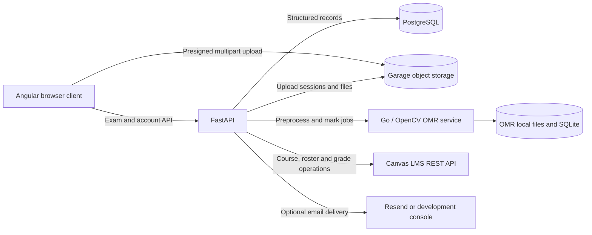

# Architecture overview

| Component | Responsibility | Source |
| --- | --- | --- |
| Angular | Course/exam workflows, template editor, annotated results, analytics, accounts | [`app/frontend`](../../app/frontend) |
| FastAPI | Business rules, grading, review/release, authentication, integrations | [`app/backend`](../../app/backend) |
| PostgreSQL | Users, courses, exams, grades, relationships, and audit records | [Models](../../app/backend/models), [migrations](../../app/backend/migrations) |
| Garage | Uploaded PDFs, images, generated documents, and presigned uploads | [Storage repository](../../app/backend/repositories/storage.py) |
| Go / OpenCV | PDF rendering, scan preprocessing, anchor alignment, mark detection, job status | [`app/omr`](../../app/omr) |
| Docker Compose | Development and production service definitions | [`app/docker-compose.yml`](../../app/docker-compose.yml) |

The OMR service keeps its own files and SQLite metadata; it does not use the
application's PostgreSQL database for its persistent implementation. FastAPI
coordinates the application-facing scan and grading pipeline.

The original plan proposed LTI, Redis/ARQ, and MinIO. The submitted implementation
uses local accounts, Canvas REST API integration, and Garage. Read those planning
documents as historical requirements rather than current deployment instructions.

See the [final project report](../final/OMR%20System%20Final%20Project%20Report.md#2-system-architecture)
for detailed data-flow diagrams, and the OMR Service Final Report in
[`docs/final`](../final) for recognition internals and component benchmarks.
