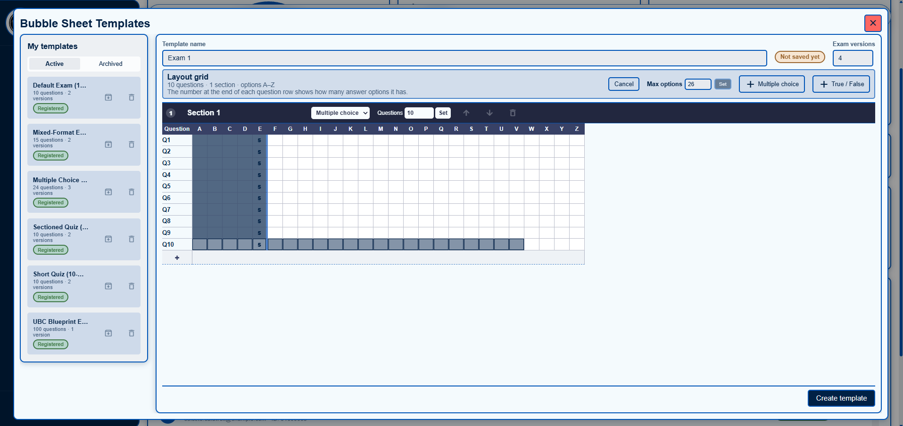
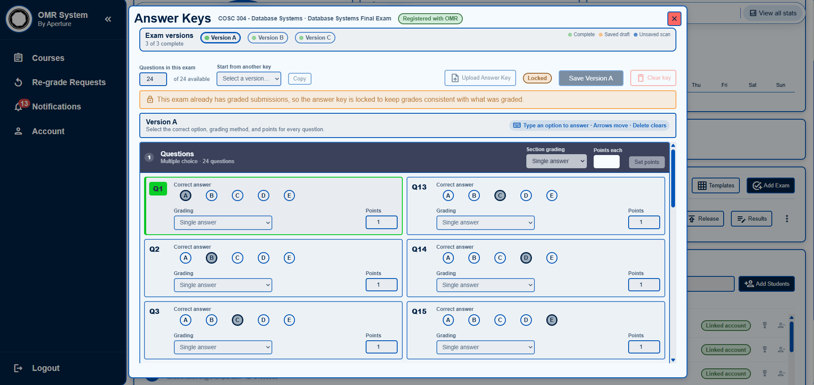
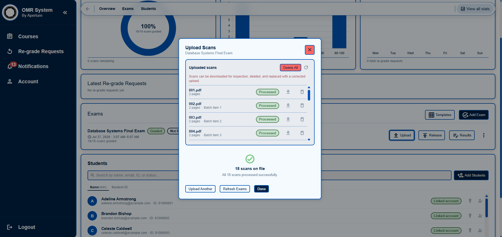
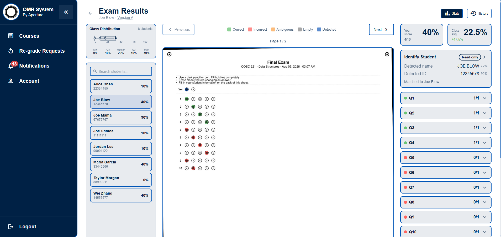
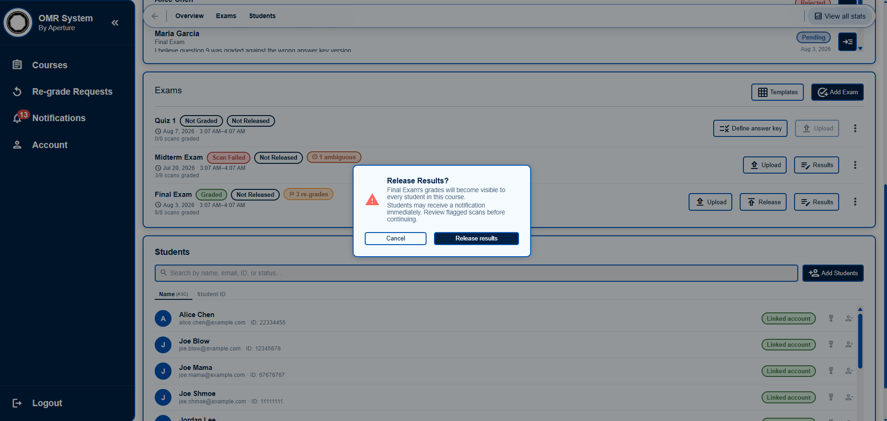
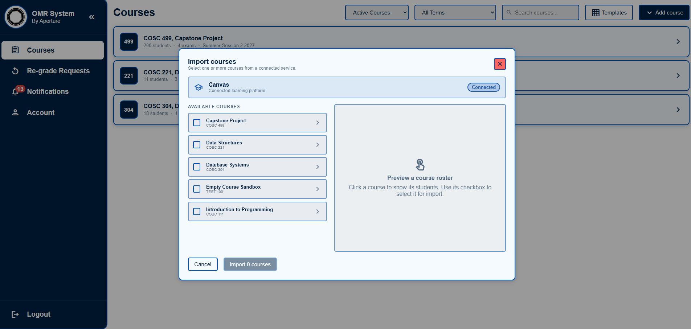

# Application screenshot gallery

These are the original application screenshots embedded in Team 15's final
project report, extracted at their embedded resolution. They have not been
redesigned or generated with AI. They show the submission-era interface using
seeded demonstration records; names and IDs visible here match synthetic seed
data. No screenshot is evidence of a current production deployment.

## Template editor

Reusable bubble-sheet layouts, sections, question options, and versions.

## Answer keys

Version-specific answers and grading configuration in the exam workflow.

## Scan uploads

Batch processing with per-file status and a completion summary.

## Exam review

The scanned sheet, detected answers, student matching, and grade controls together.

## Grade release

A confirmation explains when grades become visible to students.

## Canvas integration

Course import from the connected local Canvas demonstration environment.

## Source and reuse

| Image | Final report PDF page / image on page |
| --- | --- |
| Template editor | 41 / second |
| Answer-key editor | 42 / first |
| Scan upload | 42 / second |
| Exam review | 42 / third |
| Grade release | 43 / first |
| Canvas course import | 44 / first |

Source: [`OMR System Final Project Report.pdf`](../../final/OMR%20System%20Final%20Project%20Report.pdf).
Credit Team 15 and link the [contributors](../../../CONTRIBUTORS.md) when reusing
these images. University/team permission and included branding remain subject to
the [publication review](../publication.md). An additional analytics screenshot
would be useful later, but is not required for this gallery.

To re-extract the same images locally, install
`tools/portfolio/requirements.txt` into a tooling environment, then run
`python tools/portfolio/prepare_assets.py screenshots`
from the repository root. This does not start or change the application.
